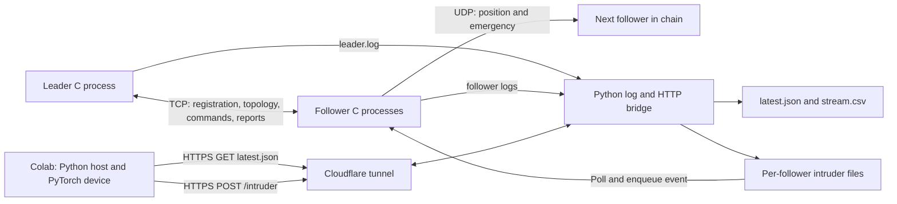
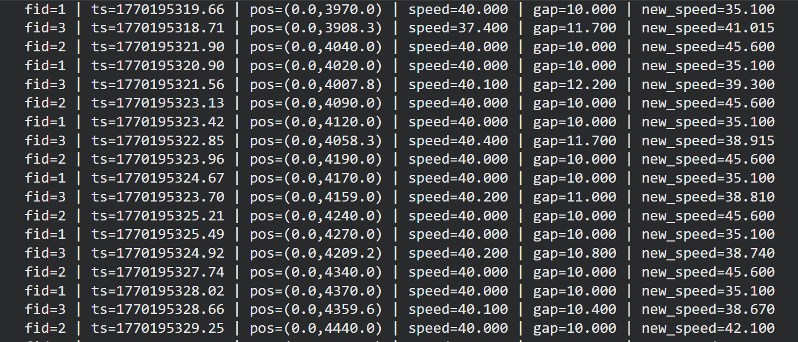

# Truck Platooning: Distributed and Parallel System

A Linux/WSL truck-platooning simulation developed for the Distributed and Parallel Systems / Embedded Systems Engineering project at Fachhochschule Dortmund. Independent C processes coordinate a leader and follower trucks using POSIX threads, TCP, UDP, priority event queues, finite-state machines, and matrix clocks.

The GPU extension connects the local simulation to a PyTorch notebook in Google Colab. The notebook mirrors a speed calculation and generates simulated intruder events that are sent back to the C followers through a Python HTTP bridge.

> **Scope:** This is an educational simulation, not a vehicle controller or a certified safety system. GPU speed outputs are displayed, not applied to the trucks. The intruder feedback path does affect the simulated follower state. No measured GPU speedup, hard real-time guarantee, or proven collision avoidance is claimed.

## Contents

- [Implemented functionality](#implemented-functionality)
- [Architecture](#architecture)
- [Repository structure](#repository-structure)
- [Build](#build)
- [Run the local simulation](#run-the-local-simulation)
- [Run the GPU/Colab extension](#run-the-gpucolab-extension)
- [Control and timing](#control-and-timing)
- [Tests](#tests)
- [Troubleshooting](#troubleshooting)
- [Project materials and attribution](#project-materials-and-attribution)

## Implemented functionality

| Area | Implementation |
| --- | --- |
| Platoon formation | Followers register their IP/UDP port over TCP. The leader assigns IDs and spawn poses. The initial formation requires three followers. |
| Topology management | The leader maintains the ordered follower list and distributes rear-neighbor information when membership changes. |
| Cruise control | A local proportional/relative-speed controller adjusts follower speed using front-truck position and speed. A turn queue preserves leader turn locations. |
| Emergency behavior | A follower stops, forwards an emergency to its rear neighbor over UDP, and uses a local timer to leave emergency mode. The leader can broadcast emergency commands over TCP. |
| Leader liveness | A follower watchdog monitors freshness of leader TCP messages and requests `STOPPED` when they become stale. |
| Intruder handling | Keyboard or GPU-generated events enter `INTRUDER_FOLLOW`, enlarge the target gap, and notify the leader. Clear events restore the normal target. |
| Logical clocks | Matrix-clock helpers increment local entries and merge received matrices. Integration is partial; this is not a distributed-consensus protocol. |
| GPU extension | A threaded log bridge exposes JSON, Colab performs PyTorch operations, and HTTP POST feedback becomes per-follower file-based IPC. |

The standard demonstration is **one leader plus three followers**, matching the four-entry matrix-clock dimension. Although the leader's session array has five follower slots, running more than three real followers is not supported safely without auditing the clock dimensions and ID handling.

## Architecture



### Leader and followers

The leader handles TCP registration, follower messages, keyboard input, periodic motion ticks, command sending, and its state machine in concurrent execution paths. Followers independently receive TCP commands and UDP neighbor updates while running their state machine, physics loop, keyboard listener, watchdog, and GPU-file listener.

Events are consumed by one FSM thread per process. The event queue selects the lowest-numbered pending event type first: emergency has priority `0`, and leader timeout has priority `1`. Each event-type ring has 32 storage slots, with one reserved slot, so its effective capacity is 31 events. Mutexes and condition variables protect the queue; overflow is logged and the new event is dropped.

This is fixed-priority event selection, **not earliest-deadline-first scheduling**. The follower's `SCHED_FIFO` configuration calls are commented out in the supplied source. The FSM is a single event consumer, but other threads also update shared state; it is not a complete single-writer architecture.

### CPU control versus GPU work

| Component | Executes where | Controls motion? |
| --- | --- | --- |
| C cruise controller, physics, emergency handling, watchdog | Local Linux/WSL CPU | Yes |
| Log parsing, HTTP requests, JSON, file IPC | Local/Colab CPU | Transfers observations and intruder events |
| PyTorch cruise mirror | Colab CUDA device, or CPU fallback | No; calculated speed is printed only |
| PyTorch grid and random intruder scan | Colab CUDA device, or CPU fallback | Indirectly; the resulting Boolean becomes a C intruder event |

See [GPU implementation details](docs/GPU.md) for the complete round trip, data formats, and limitations.

## Repository structure

```text
.
|-- src/                      # Primary C implementation, including GPU-file listener
|-- include/                  # Shared types, configuration, and module interfaces
|-- tests/                    # CUnit suites, socketpair integration, Python checks
|   `-- support/              # State fixtures for isolated C unit tests
|-- gpu/
|   |-- gpu_stream.py         # Standard-library log bridge and HTTP server
|   |-- colab_gpu_cruise_demo.ipynb
|   `-- requirements-colab.txt
|-- scripts/                  # Runtime preparation and bounded test runner
|-- docs/
|   |-- GPU.md
|   |-- TESTING.md
|   |-- PROJECT_MATERIALS.md
|   |-- diagrams/             # Allocation, sequence, original team diagrams
|   |-- images/               # Implementation/GPU screenshots
|   |-- media/                # GPU demonstration video
|   `-- presentation/         # Team presentation from the supplied submission ZIP
|-- reference/cpu-only/       # Original CPU-only source from the submission ZIP
|-- runtime/                  # Generated logs, JSON, CSV, intruder IPC; ignored by Git
|-- .github/workflows/ci.yml
|-- Makefile
`-- LICENSE                   # Original upstream MIT notice, retained unchanged
```

`src/` is the maintained entry point for this organized snapshot. `reference/cpu-only/` preserves the original submitted source for comparison; it is not built by the top-level Makefile. Duplicate ZIPs, executables, object files, old telemetry, expired tunnel settings, and unrelated coursework are not published.

## Build

Use Linux or Ubuntu under WSL. Native Windows compilation is not supported by the supplied code because it uses POSIX sockets, terminal APIs, pthreads, and Linux `timerfd`.

```bash
git clone https://github.com/shawrajdeep00/truck-platooning-distributed-parallel-system.git
cd truck-platooning-distributed-parallel-system

sudo apt-get update
sudo apt-get install -y build-essential libcunit1-dev python3 curl

make -j2
```

The executables are `bin/leader` and `bin/follower`. CUnit is only required for the C test suites. The local GPU bridge uses Python's standard library and does not require PyTorch or a local NVIDIA GPU.

Useful targets:

```bash
make help
make test-binaries
make test-python
make test
make clean
```

`make clean` removes generated build files, not your telemetry. **`make test` currently returns a failure because four existing cruise-control assertions fail.** The runner still executes the other suites; details are in [Testing](docs/TESTING.md).

## Run the local simulation

Run all commands from the cloned repository root. Use a separate interactive terminal for each process. Keep the default TCP port `5000`; the follower's connection settings are compiled into `include/truckplatoon.h`.

### 1. Prepare a fresh run

Stop any previous leader, follower, bridge, tunnel, and Colab loop first. The following command resets only the named demo files inside this repository's `runtime/` directory:

```bash
python3 scripts/prepare_runtime.py --reset
```

To create missing runtime files without clearing an existing run, use `make prepare-runtime` instead.

### 2. Start the leader

```bash
stdbuf -oL -eL ./bin/leader 2>&1 | tee runtime/leader.log
```

### 3. Start three followers in order

Wait for each follower to receive its ID before starting the next one. This keeps the log labels and GPU feedback files aligned with IDs `1`, `2`, and `3`.

Follower 1:

```bash
GPU_INTRUDER_FILE="$PWD/runtime/intruder_1.txt" \
  stdbuf -oL -eL ./bin/follower 5001 2>&1 | tee runtime/follower1.log
```

Follower 2:

```bash
GPU_INTRUDER_FILE="$PWD/runtime/intruder_2.txt" \
  stdbuf -oL -eL ./bin/follower 5002 2>&1 | tee runtime/follower2.log
```

Follower 3:

```bash
GPU_INTRUDER_FILE="$PWD/runtime/intruder_3.txt" \
  stdbuf -oL -eL ./bin/follower 5003 2>&1 | tee runtime/follower3.log
```

Once the leader reports that topology is finalized and controls are unlocked, press `w` in the leader terminal to increase its speed. Use `q` to stop a process; `Ctrl+C` is also available. Keep stderr in the logs (`2>&1`): the bridge uses a shutdown message printed there to recognize a closed leader connection.

### Keyboard controls

| Process | Key | Action |
| --- | --- | --- |
| Leader | `w` / `s` | Increase/decrease speed by `0.5` per keypress |
| Leader | `a` / `d` | Queue a left/right turn |
| Leader | Space | Emergency brake and TCP emergency broadcast |
| Leader | `p` | Toggle stale mode: pause motion updates and periodic commands without closing connections |
| Leader | `q` | Request shutdown after formation; use `Ctrl+C` if still waiting for followers |
| Follower | `i` | Toggle a keyboard intruder event |
| Follower | `e` | Enter emergency braking and propagate rearward over UDP |
| Follower | `q` | Request shutdown |

Test keyboard intruders and GPU intruders separately; they are independent event producers, not a coordinated ownership mechanism.

## Run the GPU/Colab extension

First start the local simulation as described above. Keep all local processes running throughout the remote experiment.

### 1. Start one bridge for all followers

In a fifth terminal, from the repository root:

```bash
python3 -u gpu/gpu_stream.py \
  --leader-log "$PWD/runtime/leader.log" \
  --follower-log "1:$PWD/runtime/follower1.log" \
  --follower-log "2:$PWD/runtime/follower2.log" \
  --follower-log "3:$PWD/runtime/follower3.log" \
  --out "$PWD/runtime/latest.json" \
  --csv "$PWD/runtime/stream.csv" \
  --intruder-out "$PWD/runtime/intruder_{id}.txt" \
  --serve --port 8000
```

Use absolute paths as shown. The HTTP server changes its working directory to the output directory. Serving only `runtime/` avoids publishing the source tree through the demo server.

The bridge starts reading at the end of each log, so it requires **new** leader and follower output. It does not replay old logs. Check local JSON after a few fresh status updates:

```bash
curl --fail --show-error http://127.0.0.1:8000/latest.json
```

### 2. Start the optional Cloudflare tunnel

With `cloudflared` installed in the same Linux/WSL environment, run in another terminal:

```bash
cloudflared tunnel --url http://127.0.0.1:8000
```

Use the **newly printed** HTTPS hostname. Quick Tunnel hostnames change when a new tunnel is created. If QUIC cannot connect on your network, an alternative command is:

```bash
cloudflared tunnel --protocol http2 --url http://127.0.0.1:8000
```

Verify that `https://YOUR-TUNNEL.trycloudflare.com/latest.json` returns JSON before starting the Colab loop. Cloudflare carries HTTP requests; it does not run the model or parse the telemetry for the application.

> **Demo security:** This HTTP server binds to all interfaces, serves the contents of `runtime/`, and accepts unauthenticated intruder commands. A random tunnel URL is not authentication. Use only a trusted, temporary simulation session, do not put secrets in `runtime/`, and stop the tunnel and server afterward. Do not expose this endpoint for real vehicle control.

### 3. Open the notebook and select a GPU

[Open the repository notebook in Google Colab](https://colab.research.google.com/github/shawrajdeep00/truck-platooning-distributed-parallel-system/blob/main/gpu/colab_gpu_cruise_demo.ipynb).

Select a GPU runtime, then execute the cells in order. PyTorch and Requests are normally available in Colab; `gpu/requirements-colab.txt` lists the notebook's Python dependencies. The previously recorded demonstration used an **NVIDIA Tesla T4**; a later Colab session may allocate a different device or no GPU.

Set the notebook's URL cell to the current tunnel:

```python
LIVE_URL = "https://YOUR-TUNNEL.trycloudflare.com/latest.json"
```

The next cell derives the POST endpoint by replacing `/latest.json` with `/intruder`. The live loop reads each follower's sample, computes the display-only speed mirror, performs the synthetic grid scan, posts the intruder state, and prints a status line. It sleeps `0.5` seconds after each pass, in addition to HTTP and computation time; this is not a guaranteed 2 Hz control loop.

The notebook has no TTC calculation. Original computation parameters are preserved and their differences from the C controller are documented in [GPU.md](docs/GPU.md).

### 4. Check the feedback path

An active event should produce a line such as:

```text
7 2 1 40 10 5000 1760000000.0
```

in `runtime/intruder_2.txt`. The fields are:

```text
sequence  target_follower_id  active  speed  length  duration_ms  epoch_seconds
```

Follower 2 polls its configured file every `200` ms. A new activation becomes `EVT_INTRUDER`; a clear becomes `EVT_INTRUDER_CLEAR`. In normal operation the FSM changes to `INTRUDER_FOLLOW`, updates the target gap to `TARGET_GAP + intruder_length`, and sends an intruder report to the leader. The leader currently uses an active report's speed as its own speed and continues sending commands. A clear report returns the leader to `CRUISE`; it does not restore a separately saved pre-intruder speed.

The `5000` ms duration is transmitted but the GPU-file path does **not** automatically enforce a five-second hold. Subsequent clear events determine the end of the episode. See [known limitations](docs/GPU.md#limitations-and-interpretation) before describing this experiment as object detection or GPU-offloaded control.

## Control and timing

The C controller calculates:

```text
gap = sqrt((my_x - front_x)^2 + (my_y - front_y)^2)
projected_error = (gap - target_gap) - front_speed * CONTROL_DT
new_speed = leader_base_speed
            + 0.70 * (front_speed - current_speed)
            + 0.35 * projected_error
new_speed = clamp(new_speed, 0, leader_base_speed + MAX_SPEED_OVER_BASE)
```

For the first follower, the front reference is the leader. Subsequent followers use position and speed from their immediate predecessor. Normal target gap is `10.0`; intruder mode adds the reported intruder length. These equations describe the implementation, not a proof of stability or safety.

| Parameter | Value | Source |
| --- | --- | --- |
| Leader TCP port | `5000` | `include/truckplatoon.h` |
| Example follower UDP ports | `5001`, `5002`, `5003` | Follower command-line arguments |
| Initial formation threshold | Three followers | `src/leader.c` |
| Matrix-clock dimension | `4 x 4` | `include/matrix_clock.h` |
| Leader tick / follower physics / C control timestep | `250 ms` | `include/truckplatoon.h` |
| Normal gap / extra-speed clamp | `10.0` / `100.0` | `include/truckplatoon.h` |
| Console status decimation | Every five ticks, approximately `1.25 s` | `include/truckplatoon.h` |
| Leader receive timeout / watchdog check period | `2000 ms` / `100 ms` | `include/truckplatoon.h` |
| GPU-file polling period | `200 ms` | `include/truckplatoon.h` |
| Turn queue capacity | `16` | `include/cruise_control.h` |

### Heartbeat flow

There is **no separate UDP heartbeat protocol** in the current source. Any received leader TCP message refreshes a monotonic last-receive timestamp. The watchdog ignores initial `PLATOONING`, checks every `100` ms, and enqueues one timeout event when message age exceeds `2000` ms. In `CRUISE` or `INTRUDER_FOLLOW`, the FSM handles that event by setting speed to zero and entering `STOPPED`.

A new cruise command resumes control from `STOPPED`; a topology message alone does not. A closed TCP connection follows the separate shutdown path, not an automatic reconnection loop. To demonstrate stale-message detection, press `p` on the leader, wait for follower watchdog messages, then press `p` again.

### Deployment limits

The networking code exchanges raw C message structures and assumes a trusted, compatible build/environment. It is not an authenticated, endian-independent protocol and does not consistently handle every partial TCP read/write. Matrix-clock handling and shared-state locking also need further review before deployment beyond this educational localhost demonstration. Do not infer production fault tolerance from the presence of TCP, a watchdog, or priority queues.

## Tests

```bash
make test

# Individual suites:
make test-heartbeat
make test-matrix-clock
make test-cruise-control
make test-intruder
make test-leader-integration
make test-python
```

Results from the organized snapshot, checked on Ubuntu/WSL:

| Suite | Result | What it actually checks |
| --- | --- | --- |
| Heartbeat | 6/6 cases, 15 assertions pass | A standalone liveness model; not production follower threads or sockets |
| Matrix clock | 11/11 cases, 33 assertions pass | Initialization, increments, merges, and helper integration |
| Intruder | 11/11 cases, 214 assertions pass | Isolated helper behavior, generated ranges, state/clock updates |
| Cruise control | 9/13 cases pass; four assertions fail | Existing controller/queue/clock expectations, some inconsistent with current constants or inputs |
| Leader integration | Scenario passes | Registration, topology reconfiguration, disconnect handling, and report-to-event delivery using UNIX socket pairs |
| Python bridge/tooling | 7/7 checks pass | Log patterns, two-follower HTTP round trip, POST IPC, disconnect marking, notebook syntax, and runtime preparation |

The new test fixtures supply missing follower globals without starting a whole follower process. CUnit runners return a nonzero status when assertions fail. The original assertion bodies are not weakened to obtain a green result. Build warnings and test coverage limitations are recorded in [docs/TESTING.md](docs/TESTING.md).

CI builds the simulator and runs the supported checks. The known-failing legacy cruise step is explicitly allowed to fail and reported in the workflow summary; a green workflow is **not** an all-legacy-tests-pass claim. No cloud GPU, Cloudflare connection, or real-time timing benchmark is exercised by CI.

## Troubleshooting

| Symptom | Check |
| --- | --- |
| `bind: Address already in use` | Inspect `ss -ltnp` / `ss -lunp`; stop only the old process using the required port. Do not start a second leader. |
| Leader controls do nothing | Wait for three registered followers and the finalized-topology message. |
| `latest.json` is missing | Pre-create logs, keep leader/followers running, and wait for fresh status output after starting the bridge. Verify absolute log paths. |
| Colab prints `Waiting for live JSON...` | First test local GET, then public GET. Check the current hostname and `/latest.json` suffix, HTTP status, response body, and whether the bridge is still alive. |
| Intruder POST appears ineffective | Check the file's sequence/target ID, the follower's assigned ID, and its `GPU_INTRUDER_FILE` path. The follower must be in a state that handles intruder events. |
| Follower IDs change after a disconnect | Restart the GPU demonstration with a stable three-follower topology. Manual bridge labels do not automatically follow reassigned IDs. |
| GPU unavailable | Select a GPU runtime and inspect `torch.cuda.is_available()` / the printed device. CPU fallback does not demonstrate CUDA execution. |
| Test prints `[PASS]` before a failure | Some inherited tests print that text unconditionally. Read CUnit's final assertion summary and the process exit code. |

Stop the Colab loop before restarting or resetting local runtime files. Then stop the tunnel, bridge, and truck processes. Do not leave a public writable demo endpoint running unattended.

## Project materials and attribution

- [GPU implementation notes](docs/GPU.md)
- [Test results and known gaps](docs/TESTING.md)
- [Submission ZIP provenance, original project links, and material index](docs/PROJECT_MATERIALS.md)
- [Team presentation](docs/presentation/truck-platooning-team-1.pptx)
- [GPU demonstration video](docs/media/gpu-implementation-demo.webm)
- [SysML allocation diagrams](docs/diagrams/allocation/)
- [SysML sequence diagrams and Visual Paradigm source](docs/diagrams/sequence/)



**Project team:** Bernard Widjaja, Md Saidur Rahman, Meghana Hemesh Kumar, and Rajdeep Shaw. The project was developed collaboratively; this repository organizes the supplied workspace and Group 01 submission rather than claiming sole authorship.

The original source repository is [saidurrsaied/DPS-ESE](https://github.com/saidurrsaied/DPS-ESE). The existing MIT license and its original copyright notice are preserved in [LICENSE](LICENSE). Original presentations and diagrams are credited to the project team and retained as project materials; no additional ownership of those assets is asserted.
